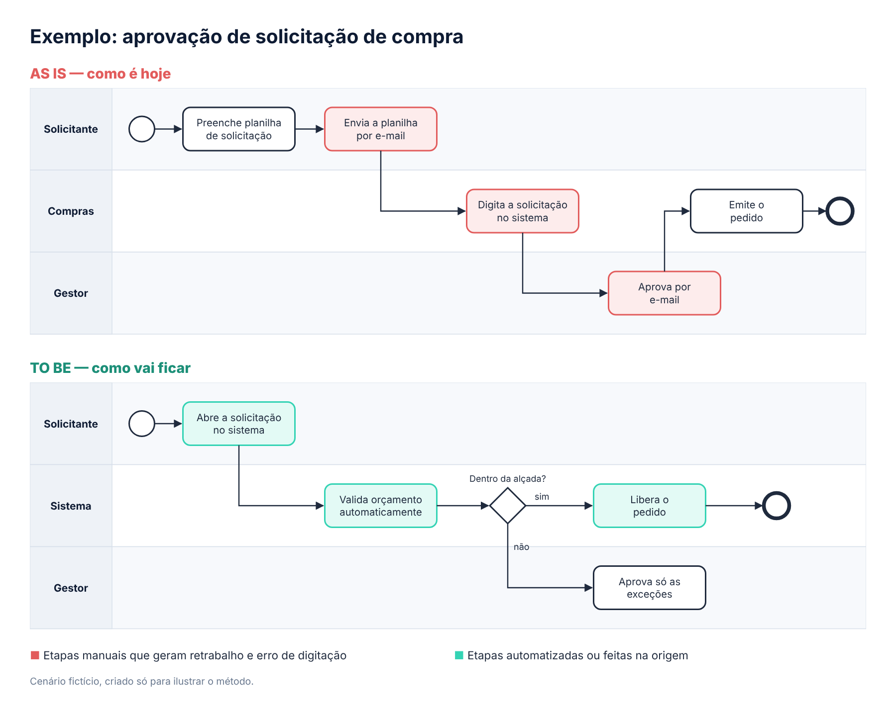
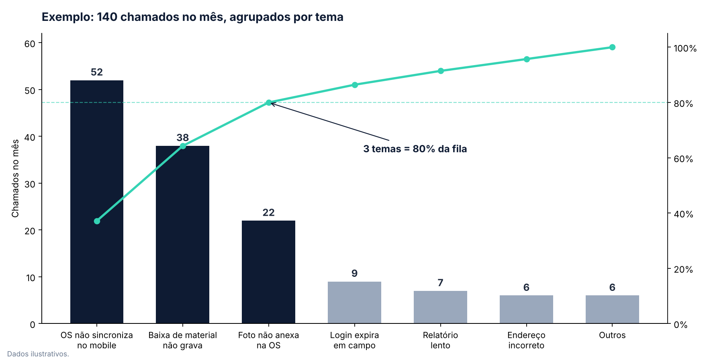
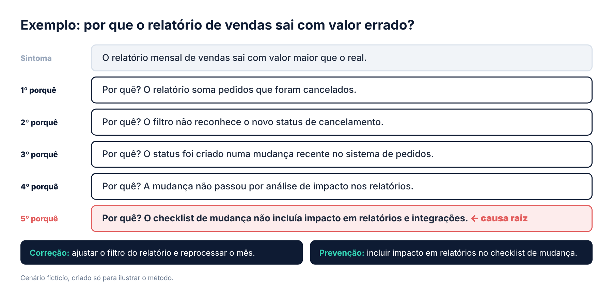
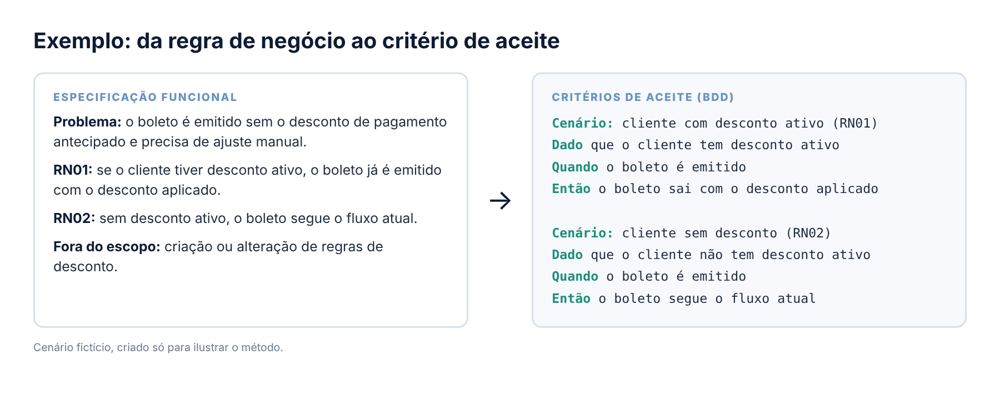

# Ferramentas e frameworks

[← Voltar ao início](./README.md)

Esta página reúne ferramentas e estruturas de pensamento aplicadas à análise, à gestão de projetos e à investigação de problemas.

## 1. BPMN — AS IS e TO BE

**O que é:** BPMN (Business Process Model and Notation) é a notação padrão para desenhar processos. Raias mostram quem faz, setas mostram a ordem e o losango mostra uma decisão.

- **AS IS:** o processo como ele é hoje, validado com quem executa.
- **TO BE:** o processo como vai ficar depois da solução.

**Como aplico**
1. **Levanto o AS IS** com usuários e key users, sem julgar ainda.
2. **Marco os pontos de dor:** retrabalho, digitação manual, espera e retorno.
3. **Desenho o TO BE** com a área de negócio, mostrando o que sai, o que é automatizado e quem passa a fazer o quê.
4. **Uso a comparação como base** da especificação funcional e dos critérios de aceite.

**Exemplo prático**

No AS IS, a solicitação passa por planilha, e-mail, redigitação em Compras e aprovação por e-mail. No TO BE, o solicitante abre direto no sistema, o sistema valida o orçamento e o gestor aprova só o que está fora da alçada.

Cenário fictício, criado só para ilustrar o método.

## 2. Pareto aplicado à Gestão de Problemas

**O que é:** o Princípio de Pareto, ou regra 80/20, diz que poucas causas costumam gerar a maior parte dos efeitos. No gráfico, as barras mostram cada causa do maior para o menor, e a linha mostra o percentual acumulado. O ponto onde a linha cruza 80% indica onde está o foco.

**Quando uso:** quando a fila de chamados é maior do que a capacidade de correção e é preciso decidir com dado o que atacar primeiro.

**Como aplico**
1. **Agrupo os chamados por tema**, e não um a um. Descrições diferentes muitas vezes escondem a mesma causa.
2. **Conto a frequência de cada tema** e considero o impacto na operação.
3. **Ordeno do maior para o menor** e calculo o percentual acumulado.
4. **Priorizo os temas que somam cerca de 80%**, abrindo problema, responsável e análise de causa raiz para cada um.
5. **Repito a análise no ciclo seguinte** para confirmar se a correção reduziu a fila.

**Exemplo prático**

Em um mês com 140 chamados, a fila parecia ter dezenas de assuntos. Agrupada por tema, mostrou que **3 problemas respondiam por 112 chamados (80%)**. Em vez de atender um a um, a correção começa por esses 3. Os outros 4 temas seguem no atendimento normal.

**Planilha modelo:** [baixar a planilha 80/20 para chamados (Excel)](./planilha-80-20-chamados.xlsx). Basta cadastrar os temas e os chamados: a tabela, as faixas de prioridade e o gráfico se montam sozinhos.

Cenário fictício, criado só para ilustrar o método.

## 3. 5 Porquês — análise de causa raiz

**O que é:** técnica de investigação em que se pergunta "por quê?" a cada resposta, a partir do sintoma, até chegar à causa que, se corrigida, impede o problema de voltar.

**Como aplico**
1. **Descrevo o sintoma** com fatos: o que acontece, onde e desde quando.
2. **Pergunto "por quê?"** e só aceito resposta com evidência (log, chamado, teste ou dado).
3. **Repito** até chegar a uma causa sob controle do time ou do processo. Nem sempre são exatamente cinco.
4. **Separo correção de prevenção:** o que resolve agora e o que muda no processo para não repetir.

**Exemplo prático**

O sintoma estava no relatório, mas a causa raiz estava no processo de mudança. Ajustar só o filtro resolveria o caso; incluir a análise de impacto no checklist evita que ele volte.

Cenário fictício, criado só para ilustrar o método.

## 4. Simulador de Prazos de Projetos — PERT + Monte Carlo

**Objetivo:** tornar explícita a incerteza das estimativas de prazo e apoiar conversas mais realistas sobre previsão de entrega.

A ferramenta permite informar estimativas otimista, mais provável e pessimista para cada etapa, escolher o método de distribuição e executar simulações para observar a variação dos prazos.

**Principais recursos**
- Distribuições Beta-PERT e Triangular.
- Leitura de percentis como P50, P80 e P90.
- Análise da entrega restante a partir de um marco selecionado.
- Datas previstas descontando fins de semana e feriados nacionais.
- Relatório em PDF.

**Acessos:** [Aplicação publicada](https://millerkbarros.github.io/simulador-pert-monte-carlo/) · [Repositório do código](https://github.com/millerkbarros/simulador-pert-monte-carlo)

## 5. Especificação funcional e BDD

**O que é:** a especificação funcional traduz a necessidade do negócio em regras claras. O BDD (Behavior-Driven Development) escreve cada regra como um cenário testável: **Dado**, **Quando**, **Então**.

**Como aplico**
1. **Começo pelo problema:** o que o usuário precisa resolver, e por quê.
2. **Numero as regras** (RN01, RN02…) para todos falarem da mesma regra.
3. **Uso exemplos reais:** um caso com dados explica mais que três parágrafos.
4. **Escrevo o que fica fora do escopo**, para evitar surpresa.
5. **Transformo cada regra em critério de aceite BDD.** Se não dá para testar, não está claro.

**Exemplo prático**

Cenário fictício, criado só para ilustrar o método.

## 6. Ágil dentro de uma empresa ITIL

Em empresa tradicional, o trabalho é fazer o ágil caber no processo, sem brigar com ele:

- **Sprint com calendário:** o planejamento já considera as janelas de deploy.
- **Pronto de verdade:** inclui homologação e mudança aprovada.
- **Key users nos ritos:** validação curta e frequente com quem usa.
- **Backlog único:** correções de problemas e novidades na mesma priorização.
- **Report da casa:** status no formato que a gestão já conhece.

## 7. Práticas de melhoria contínua

Práticas que combino conforme o problema:

- **Lean Thinking:** identificar desperdícios e gargalos no fluxo de trabalho.
- **Kaizen:** promover melhorias contínuas e incrementais.
- **5S:** organizar ambientes, informações e rotinas de trabalho.
- **Six Sigma:** usar análise estruturada para compreender variação e defeitos.
- **BPM:** compreender, mapear e melhorar processos de ponta a ponta.
- **Comunicação não violenta:** apoiar conversas objetivas, respeitosas e orientadas à solução.
