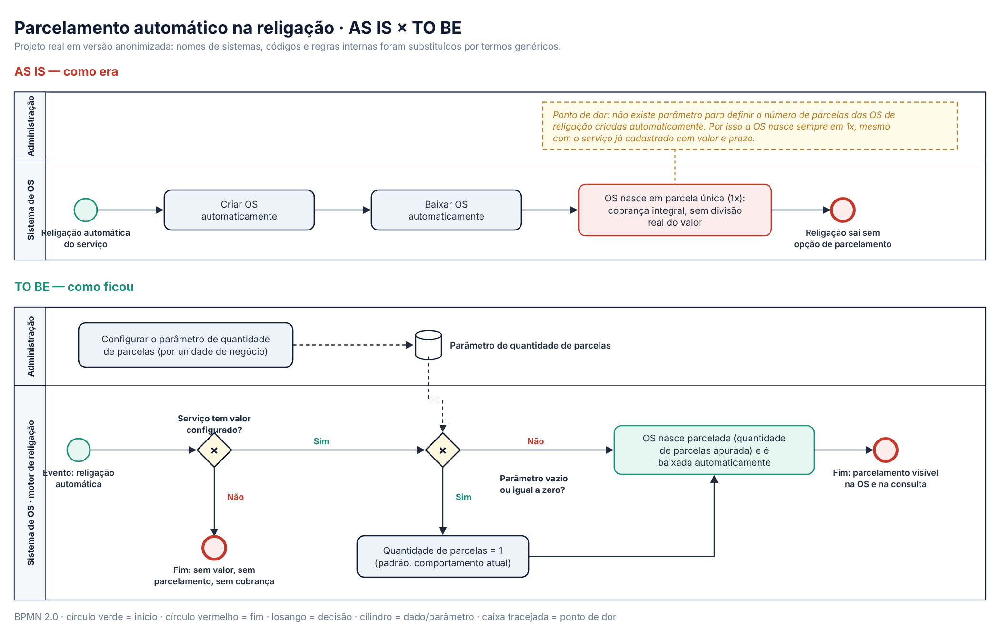
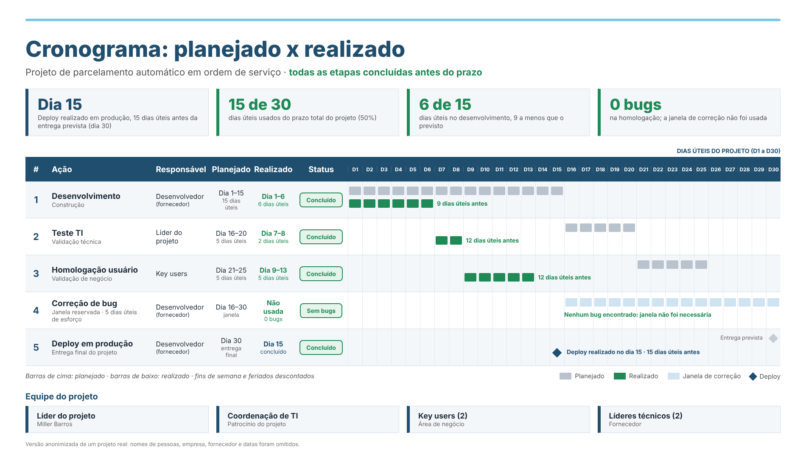

# Projetos profissionais

[← Voltar ao início](./README.md)

Iniciativas conduzidas no Grupo Águas do Brasil, no setor de saneamento, e um projeto autoral. Metas e estimativas aparecem identificadas como tal.

## 1. Simulador de Prazos de Projetos — PERT + Monte Carlo
**Projeto autoral** · out/2026 – atual

Ferramenta web que desenvolvi para dar previsibilidade aos prazos de projetos de TI.

- Estimativa PERT por etapa (otimista, mais provável e pessimista) e simulação de Monte Carlo com distribuições Beta-PERT ou Triangular.
- Probabilidade de cumprir o prazo e cenários P50 (arriscado), P80 (ideal) e P90 (seguro).
- Datas previstas de término, descontando fins de semana e feriados nacionais.
- Reestimativa do prazo restante a partir de um marco fixo, comparando realizado e previsto.
- Relatório em PDF com estimativas por etapa e premissas.

**Links:** [Abrir simulador](https://millerkbarros.github.io/simulador-pert-monte-carlo/) · [Código-fonte](https://github.com/millerkbarros/simulador-pert-monte-carlo)

## 2. Squad de Serviços 2025
**Scrum Master** · fev/2025 – mar/2026 · 11 pessoas

Evolução do sistema de gestão de ordens de serviço usado pelas equipes de campo, com 3 épicos em produção:

- **Programação Automatizada de Ordem de Serviço:** 6 rotinas manuais de programação e reprogramação automatizadas.
- **Gestão de Materiais:** integração Geocall × Integra, controle de estoque por veículo, baixa automática por ordem de serviço e kits padrão para 33 tipos de serviço em 9 concessionárias.
- **Medição Ágil:** validações operacionais, aprovação por inspeção de qualidade, boletim de medição, relatório fotográfico e integração com o Protheus.

**Meta estimada pelo PO:** redução de 90% das ações manuais na programação de ordens de serviço.

## 3. Squad de Serviços 2024
**Scrum Master** · fev/2024 – dez/2024 · 9 pessoas

- 6 épicos entregues a partir de um escopo inicial de 2, dentro do orçamento.
- Cerca de 1 incidente por épico em produção.
- Entregas: preenchimento automático de dados de vala, novo fluxo de solicitação de apoio em campo, criação automática de ordens de serviço associadas e melhorias na apropriação e consulta de ordens de serviço.

**Estimativa de esforço:** redução de 764 h para 132 h por mês nas atividades operacionais impactadas (cerca de 83%).

## 4. Gestão de Problemas de TI e Sustentação — Operações
**Líder de Gestão de Problemas (ITIL)** · mar/2026 – atual

- Incidentes recorrentes tratados como problema, com análise de causa raiz (5 Porquês).
- Evidências levadas ao fornecedor e correções priorizadas por impacto na operação.
- Coordenação de testes, homologação e planejamento de deploy em produção.
- Status report dos problemas para a alta gestão.
- Atendimento da fila diária de chamados dos usuários internos.

**Resultado:** chamados reduzidos de 350 para 250 por mês (cerca de 29% a menos), e o volume segue caindo.

## 5. Parcelamento na Religação Automática
**Líder de Projeto** · set/2026 – out/2026 · cascata, escopo fechado

Antes, nas religações de rede e de ramal, o setor comercial precisava ajustar manualmente o número de parcelas de cada ordem de serviço. Criamos um parâmetro para a ordem de religação já nascer com o parcelamento correto configurado automaticamente, sem ajuste manual. Equipe com 2 key users, líder técnico e desenvolvedor. Atuação de ponta a ponta: regras de negócio, especificação funcional, acompanhamento do desenvolvimento, homologação e entrada em produção.

**Resultado:** 15 de 30 dias úteis usados, desenvolvimento 9 dias úteis antes do previsto, nenhum bug na homologação e deploy realizado 15 dias úteis antes da entrega prevista.

Versão anonimizada: nomes, empresa, fornecedor e datas omitidos.

## 6. Integração Engeman × Geocall — Estudo de Viabilidade
**Apoio técnico** · set/2026

Durante 20 dias de cobertura, desenhei a arquitetura de integração: ordens de serviço criadas no Engeman, enviadas ao Geocall Server, executadas no Geocall Mobile e retornadas ao Engeman. O desenho serviu de base para o fornecedor documentar a API do Engeman Mobile.

## 7. Fluxo de Ordens de Serviço
**Líder de Projeto** · nov/2024 – jun/2025 · 4 pessoas

Troca do faturamento em bloco por um modelo individualizado por serviço, com entrega no prazo e 100% de aderência ao escopo.

## 8. Sete APIs para Business Intelligence
**Líder de Projeto** · fev/2024 – dez/2024 · 6 pessoas

7 APIs entregues no prazo, em paralelo à squad do mesmo ano, que passaram a alimentar o BI com dados estratégicos.

## 9. Piloto TakaDu — Monitoramento Operacional
**Líder de Projeto** · jun/2023 – jun/2024 · 5 pessoas

Piloto de monitoramento de vazão, pressão da água e indicadores operacionais do saneamento.

## 10. Consultoria de TI em Projetos de Inovação
**Consultor de TI** · mar/2026 – atual

Acompanhamento de 3 iniciativas, ajudando a traçar o caminho de TI com as áreas de negócio e fornecedores:

- **PONFAC:** aplicativo de medição de valas com inteligência artificial.
- **GeoSaker:** câmeras para verificação de lodo nos caminhões.
- **Balança:** pesagem de resíduos de construção civil, produtos químicos e caçambas de lodo.
